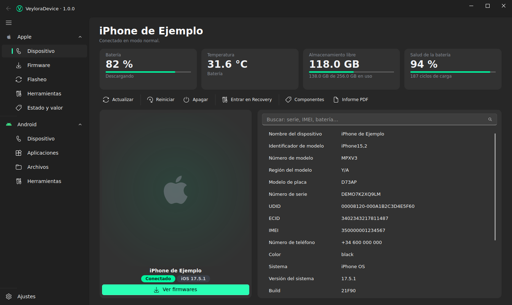
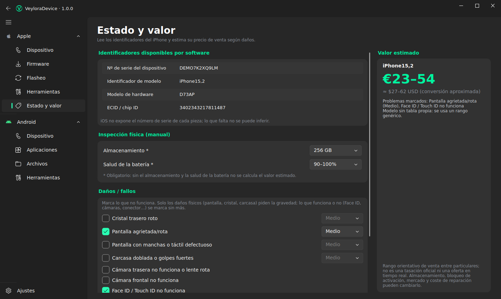
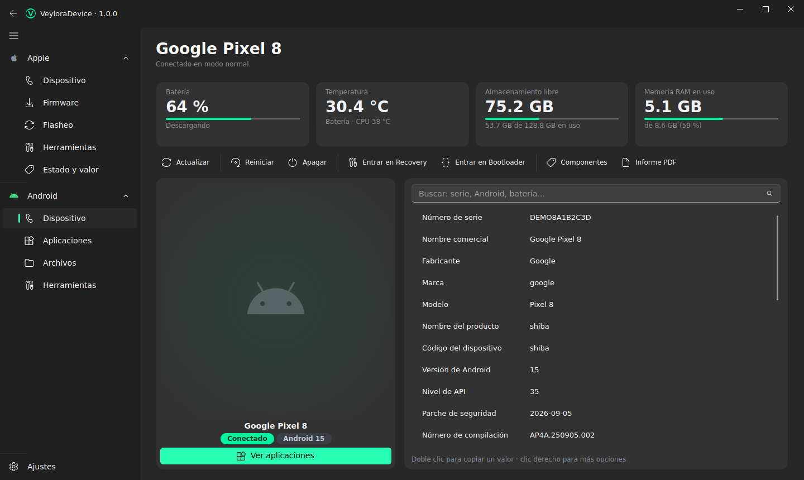
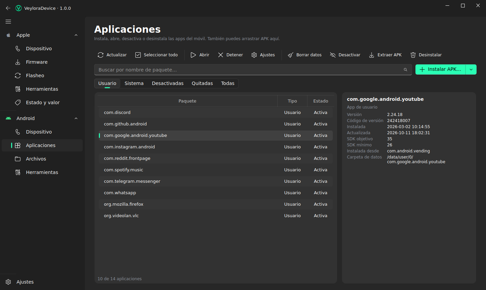
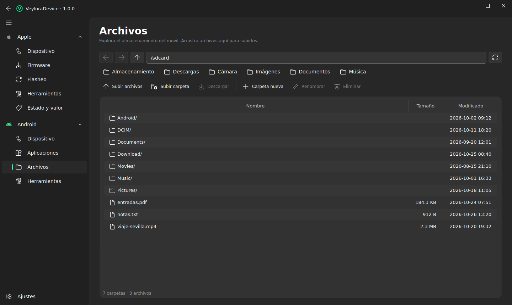
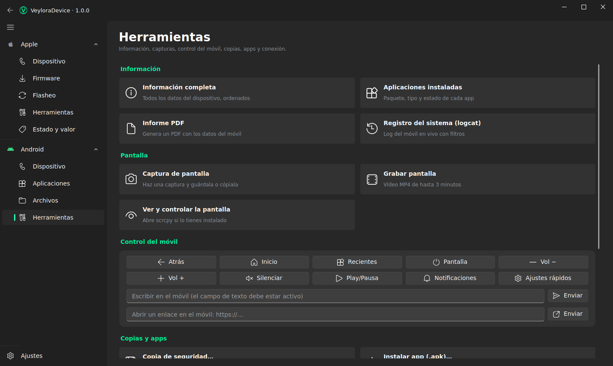
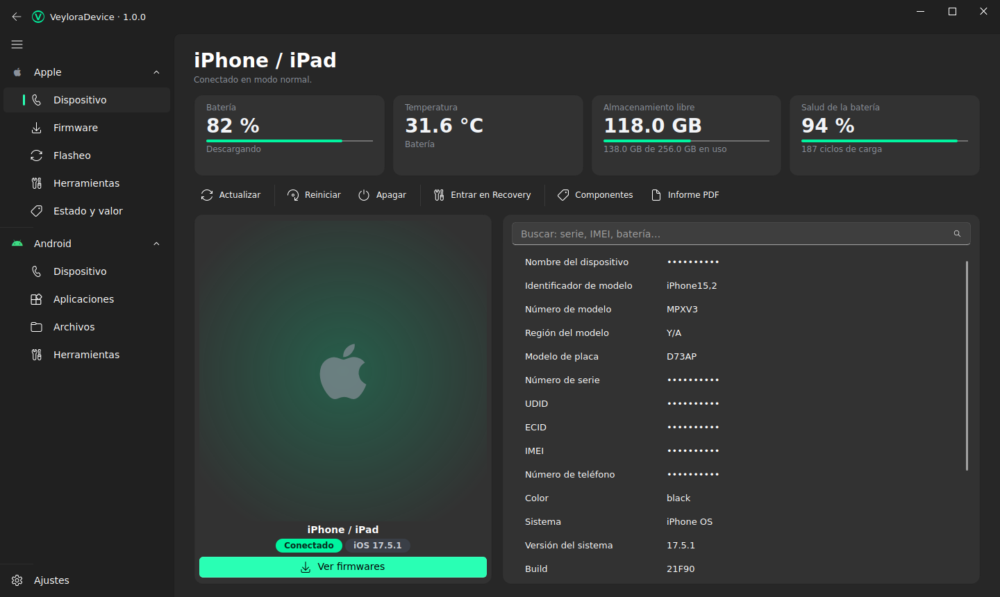
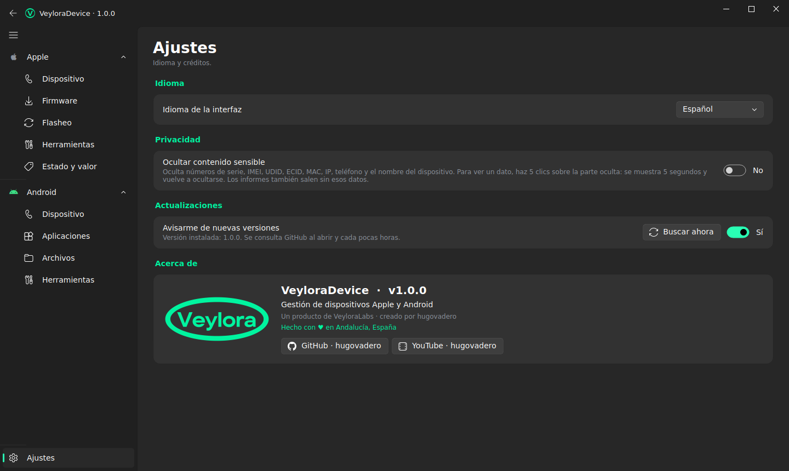
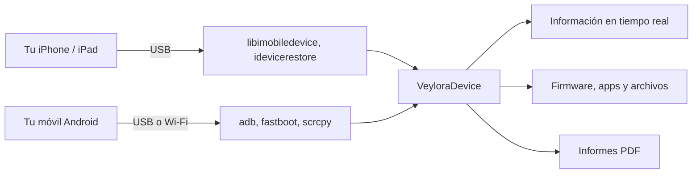

<div align="center">


# VeyloraDevice

**Gestor de dispositivos Apple y Android para Linux, todo en una sola ventana.**

Información en tiempo real, firmware, apps, archivos, capturas y valoración de tu iPhone, iPad o móvil Android.

[](LICENSE)
[](#-descarga-e-instalación)
[](https://github.com/VeyloraLabs/VeyloraDevice/releases/latest)
[](https://www.python.org/)
[](https://doc.qt.io/qtforpython-6/)
[](https://github.com/VeyloraLabs/VeyloraDevice)

[Descargar](https://github.com/VeyloraLabs/VeyloraDevice/releases/latest) · [Capturas](#-capturas) · [Características](#-características) · [Instalación](#-descarga-e-instalación) · [Compilar](#-compilar-desde-el-código) · [Contribuir](#-contribuir)

</div>



---

## 📑 Tabla de contenidos

- [Capturas](#-capturas)
- [Qué es](#-qué-es)
- [Características](#-características)
- [Descarga e instalación](#-descarga-e-instalación)
- [Programas externos que necesita](#-programas-externos-que-necesita)
- [Preparar el dispositivo](#-preparar-el-dispositivo)
- [Uso](#-uso)
- [Privacidad](#-privacidad)
- [Compilar desde el código](#-compilar-desde-el-código)
- [Estructura del proyecto](#-estructura-del-proyecto)
- [Solución de problemas](#-solución-de-problemas)
- [Roadmap](#-roadmap)
- [Contribuir](#-contribuir)
- [Licencia](#-licencia)
- [Agradecimientos](#-agradecimientos)

## 📸 Capturas

> [!NOTE]
> Todas las capturas usan **datos inventados** (números de serie, IMEI, teléfono, apps…). Sin conexión a internet la foto del móvil no sale y se ve el logo de Apple o de Android.

| Apple · Dispositivo | Apple · Estado y valor |
|:---:|:---:|
|  |  |
| **Android · Dispositivo** | **Android · Aplicaciones** |
|  |  |

<details>
<summary><b>Ver más capturas</b></summary>

| Android · Archivos | Android · Herramientas |
|:---:|:---:|
|  |  |
| **Contenido sensible oculto** | **Ajustes** |
|  |  |

</details>

## 💡 Qué es

VeyloraDevice es una alternativa libre a herramientas como 3uTools pensada para **Linux**. Conectas un iPhone, un iPad o un móvil Android por USB y tienes en una sola aplicación su información, sus apps, sus archivos y las herramientas de mantenimiento, con el mismo aspecto y los mismos botones para los dos sistemas.

Está pensada para quien repara, revende o simplemente mantiene sus propios dispositivos y no quiere tener una herramienta para cada sistema.



## ✨ Características

### Las dos plataformas

- **Franja de datos esenciales en tiempo real**: batería, temperatura, almacenamiento libre y RAM (Android) o salud de la batería con ciclos de carga (Apple).
- **Tabla de datos con buscador**: doble clic copia un valor, clic derecho ofrece más opciones.
- **Informe PDF** con los datos del dispositivo.
- **Asistente de conexión**: cuando algo falla, un aviso explica el problema y ofrece el arreglo en un clic.
- **Ocultar contenido sensible**: números de serie, IMEI, UDID, MAC, teléfono y nombre del dispositivo se ocultan; se ven con 5 clics durante 5 segundos.
- **Aviso de nueva versión** cuando hay un release nuevo en GitHub.
- **Español e inglés**, cambio al instante.

### Apple (iPhone, iPad, iPod)

| Sección | Qué hace |
|---------|----------|
| **Dispositivo** | Datos buscables, reiniciar, apagar, entrar y salir de Recovery, componentes e informe |
| **Firmware** | Catálogo visual de firmwares IPSW (ipsw.me) y descarga |
| **Flasheo** | Actualizar o restaurar con `idevicerestore` |
| **Herramientas** | Apps instaladas, instalar `.ipa`, syslog, copias de seguridad, reparar la conexión |
| **Estado y valor** | Identificadores y estimación del precio de venta según los daños |

### Android

| Sección | Qué hace |
|---------|----------|
| **Dispositivo** | Datos, foto del modelo, reiniciar, apagar, Recovery, Bootloader y modo Fastboot (solo lectura) |
| **Aplicaciones** | Buscar y filtrar, instalar APK (varios a la vez, carpetas enteras o arrastrando), desinstalar en lote, extraer APK, desactivar y borrar datos |
| **Archivos** | Explorador del móvil: subir, descargar, renombrar, crear carpetas y eliminar |
| **Herramientas** | Captura y grabación de pantalla, control remoto, escribir y abrir enlaces, Wi-Fi, terminal ADB, logcat en vivo y scrcpy |

## 📦 Descarga e instalación

Descarga el archivo de tu distribución desde la [página de releases](https://github.com/VeyloraLabs/VeyloraDevice/releases/latest):

| Distribución | Archivo | Instalar |
|--------------|---------|----------|
| Debian, Ubuntu, Linux Mint, Pop!_OS | `veyloradevice_X.Y.Z_amd64.deb` | `sudo apt install ./veyloradevice_X.Y.Z_amd64.deb` |
| Fedora, RHEL, Rocky, Alma | `veyloradevice-X.Y.Z-1.x86_64.rpm` | `sudo dnf install ./veyloradevice-X.Y.Z-1.x86_64.rpm` |
| openSUSE | `veyloradevice-X.Y.Z-1.x86_64.rpm` | `sudo zypper install ./veyloradevice-X.Y.Z-1.x86_64.rpm` |
| Cualquiera | `VeyloraDevice-X.Y.Z-x86_64.AppImage` | `chmod +x VeyloraDevice-*.AppImage && ./VeyloraDevice-*.AppImage` |
| Cualquiera (portable) | `VeyloraDevice-X.Y.Z-linux-x86_64.tar.gz` | `tar xzf VeyloraDevice-*.tar.gz && ./VeyloraDevice-*/VeyloraDevice` |

Comprueba la descarga con el archivo `SHA256SUMS` del release:

```bash
sha256sum -c SHA256SUMS --ignore-missing
```

> [!TIP]
> Si instalas el `.deb` o el `.rpm`, la aplicación aparece en el menú de aplicaciones como **VeyloraDevice** y también puedes lanzarla con el comando `veyloradevice`.

### Ejecutar desde el código

```bash
git clone https://github.com/VeyloraLabs/VeyloraDevice.git
cd VeyloraDevice
./run.sh
```

`run.sh` crea un entorno virtual, instala `requirements.txt` y abre la aplicación. Los programas externos se instalan con los comandos de [Programas externos que necesita](#-programas-externos-que-necesita).

## 🔧 Programas externos que necesita

VeyloraDevice no incluye estos programas: usa los de tu sistema. Solo necesitas los de la plataforma que vayas a usar.

<details open>
<summary><b>Fedora</b></summary>

```bash
sudo dnf install -y libimobiledevice libimobiledevice-utils idevicerestore ideviceinstaller usbmuxd libirecovery-utils android-tools
sudo dnf install -y dnf-plugins-core
sudo dnf copr enable -y zeno/scrcpy
sudo dnf install -y scrcpy
sudo systemctl start usbmuxd
```

</details>

<details>
<summary><b>Debian, Ubuntu y derivadas</b></summary>

```bash
sudo apt install libimobiledevice-utils ideviceinstaller idevicerestore usbmuxd libirecovery-utils adb fastboot scrcpy
```

</details>

<details>
<summary><b>Arch Linux</b></summary>

```bash
sudo pacman -S libimobiledevice usbmuxd ideviceinstaller idevicerestore android-tools scrcpy
```

</details>

| Programa | Para qué sirve | Plataforma |
|----------|----------------|------------|
| `libimobiledevice` y `usbmuxd` | Hablar con el iPhone o iPad | Apple |
| `idevicerestore` | Actualizar y restaurar firmware | Apple |
| `ideviceinstaller` | Instalar y listar apps | Apple |
| `adb` y `fastboot` | Hablar con Android | Android |
| `scrcpy` (opcional) | Ver y controlar la pantalla | Android |

## 📱 Preparar el dispositivo

**iPhone / iPad**: conéctalo por USB, desbloquéalo y pulsa **Confiar en este equipo**. La aplicación lo detecta y lo lanza sola si hace falta.

**Android**:

1. Ajustes → Acerca del teléfono → toca 7 veces **Número de compilación**.
2. Ajustes → Sistema → Opciones de desarrollador → activa **Depuración USB**.
3. Conecta el cable y acepta **¿Permitir depuración USB?**.

> [!IMPORTANT]
> **Xiaomi, Redmi y POCO** bloquean que el PC pulse Atrás o Recientes, escriba o controle la pantalla. Activa además **Depuración USB (ajustes de seguridad)** en Opciones de desarrollador (puede pedir tu cuenta Mi y una SIM). Inicio, volumen, multimedia y notificaciones funcionan sin ese ajuste, y la aplicación te lleva a él si lo necesitas.

## 🚀 Uso

1. Abre VeyloraDevice y conecta tu dispositivo: la franja superior muestra su estado en vivo.
2. Usa la **barra de acciones** de cada página (Actualizar, Reiniciar, Entrar en Recovery…).
3. En **Aplicaciones** (Android) elige *Instalar APK* y marca todos los que quieras, o arrastra una carpeta entera a la ventana. Con *Seleccionar todo* puedes desinstalar en lote.
4. Para compartir una captura o un informe, activa **Ajustes → Ocultar contenido sensible**.

### Atajos

| Tecla | Acción |
|-------|--------|
| <kbd>F5</kbd> | Actualizar |
| <kbd>Ctrl</kbd> + <kbd>F</kbd> | Buscar (Aplicaciones) |
| <kbd>Ctrl</kbd> + <kbd>I</kbd> | Instalar APK |
| <kbd>Supr</kbd> | Desinstalar / eliminar la selección |
| <kbd>Alt</kbd> + <kbd>←</kbd> / <kbd>→</kbd> / <kbd>↑</kbd> | Atrás, adelante y subir en Archivos |
| <kbd>F2</kbd> | Renombrar en Archivos |

## 🔒 Privacidad

- Todo se procesa en tu equipo. VeyloraDevice no tiene servidor propio ni envía datos de tus dispositivos a ningún sitio.
- Las únicas conexiones salientes son: `ipsw.me` y los servidores de Apple (firmware), la lista pública de dispositivos de Google Play y la API de Wikipedia (nombre y foto del modelo, sin enviar números de serie) y la API de GitHub (comprobar nuevas versiones).
- Con **Ocultar contenido sensible** activado, la tabla, los componentes, la información completa y los informes PDF ocultan serie, IMEI, UDID, ECID, MAC, IP, teléfono y nombre del dispositivo.

## 🛠️ Compilar desde el código

Todo lo necesario para compilar vive en la carpeta [`packaging/`](packaging):

```bash
cd packaging
./build.sh
```

El script:

1. Te muestra la **versión actual ya escrita** (`Version to build: 1.0.0`): pulsa <kbd>Enter</kbd> para mantenerla o edítala para sacar una nueva. La versión elegida se escribe en `app/__init__.py`, así el programa la enseña.
2. Prepara un entorno virtual propio e instala las dependencias.
3. Compila con PyInstaller y genera todos los paquetes en `packaging/compilation/Linux-<arquitectura>/`:

```text
packaging/compilation/Linux-x86_64/
├── veyloradevice_X.Y.Z_amd64.deb
├── veyloradevice-X.Y.Z-1.x86_64.rpm
├── VeyloraDevice-X.Y.Z-x86_64.AppImage
├── VeyloraDevice-X.Y.Z-linux-x86_64.tar.gz
└── SHA256SUMS
```

| Opción | Efecto |
|--------|--------|
| `-v 1.2.0` | Usa esa versión sin preguntar |
| `-y` | No pregunta nada: mantiene la versión actual |
| `-t deb,rpm` | Genera solo esos formatos (`tar`, `deb`, `rpm`, `appimage`) |

Necesitas `python3` (con `venv`), `dpkg-deb` para el `.deb`, `rpmbuild` para el `.rpm` y `curl` para descargar `appimagetool`. Lo que falte se omite con un aviso.

Para publicar un release: `./release.sh` (necesita la [GitHub CLI](https://cli.github.com) con `gh auth login`).

## 🗂️ Estructura del proyecto

```text
VeyloraDevice/
├── main.py                 Punto de entrada
├── app/
│   ├── core/               Lógica sin interfaz (ADB, libimobiledevice, informes…)
│   ├── gui/                Páginas y diálogos (PySide6 + Fluent)
│   ├── privacy.py          Ocultar contenido sensible
│   └── update.py           Aviso de nuevas versiones
├── assets/                 Logo e iconos
├── docs/screenshots/       Capturas del README
├── packaging/              Compilación (.deb, .rpm, AppImage, .tar.gz)
├── requirements.txt
└── run.sh                  Ejecutar desde el código
```

## 🩺 Solución de problemas

<details>
<summary><b>El móvil Android no aparece</b></summary>

Comprueba que **Depuración USB** está activada y acepta el aviso en el móvil. Si sigue sin salir, pulsa **Herramientas → Reiniciar servidor ADB**.

</details>

<details>
<summary><b>Dice «Linux no puede acceder al USB»</b></summary>

Desconecta y vuelve a conectar el cable. Si persiste, tu usuario no tiene permiso USB para ese móvil: revisa las reglas udev de ADB de tu distribución.

</details>

<details>
<summary><b>El iPhone no se conecta o no sale «Confiar»</b></summary>

Asegúrate de que `usbmuxd` está en marcha (`sudo systemctl start usbmuxd`). La pestaña Dispositivo explica el problema y ofrece borrar los emparejamientos guardados.

</details>

<details>
<summary><b>Los botones de control no hacen nada en un Xiaomi o Redmi</b></summary>

Activa **Depuración USB (ajustes de seguridad)** en Opciones de desarrollador. Mientras tanto Inicio, volumen y notificaciones sí funcionan.

</details>

<details>
<summary><b>Quiero borrar la caché</b></summary>

Borra la carpeta `~/.cache/veylora` (fotos de modelos y catálogos). Se vuelve a crear sola.

</details>

## 🗺️ Roadmap

- [x] Páginas de Dispositivo, Aplicaciones, Archivos y Herramientas para Android
- [x] Datos esenciales en tiempo real
- [x] Ocultar contenido sensible
- [x] Aviso de nuevas versiones
- [x] Paquetes `.deb`, `.rpm`, AppImage y `.tar.gz`
- [ ] Versión para otras arquitecturas (ARM) en los releases
- [ ] Más idiomas
- [ ] Paquete para Flathub

## 🤝 Contribuir

Las contribuciones son bienvenidas.

1. Haz un *fork* y crea una rama: `git checkout -b mi-mejora`
2. Mantén el estilo del código existente (sin comentarios, nombres claros).
3. Prueba tu cambio con un dispositivo real si puedes.
4. Abre un *pull request* explicando qué cambia y por qué.

Para avisar de un fallo, abre un *issue* con tu distribución, el modelo del dispositivo y los pasos para repetirlo. **No publiques números de serie ni IMEI**: activa *Ocultar contenido sensible* antes de capturar o generar un informe.

## 📄 Licencia

Distribuido bajo la licencia **GNU GPL v3**. Consulta [LICENSE](LICENSE).

VeyloraDevice usa [PySide6-Fluent-Widgets](https://github.com/zhiyiYo/PyQt-Fluent-Widgets), que tiene doble licencia: GPLv3 para uso no comercial y licencia comercial de pago para uso comercial. Por eso el proyecto es GPLv3. Si quieres usarlo con fines comerciales, tienes que cumplir también esa licencia. Detalle completo en [THIRD_PARTY_NOTICES.md](THIRD_PARTY_NOTICES.md).

Apple, iPhone, iPad e iOS son marcas de Apple Inc. Android es una marca de Google LLC. VeyloraDevice es un proyecto independiente, sin relación con esas compañías.

## 🙏 Agradecimientos

- [libimobiledevice](https://libimobiledevice.org/) y [idevicerestore](https://github.com/libimobiledevice/idevicerestore)
- [ipsw.me](https://ipsw.me/) por su API pública de firmwares
- [PyQt-Fluent-Widgets](https://github.com/zhiyiYo/PyQt-Fluent-Widgets) por la interfaz
- [scrcpy](https://github.com/Genymobile/scrcpy) y las Android platform tools

---

<div align="center">

Hecho con ❤️ por **[VeyloraLabs](https://github.com/VeyloraLabs)** · creado por [hugovadero](https://github.com/hugovadero)

</div>
