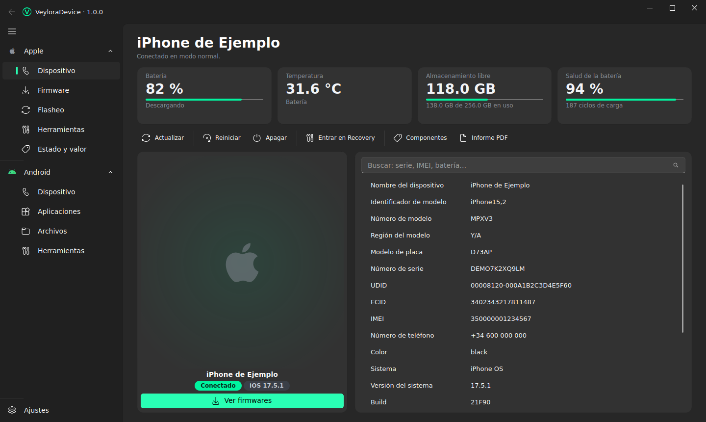
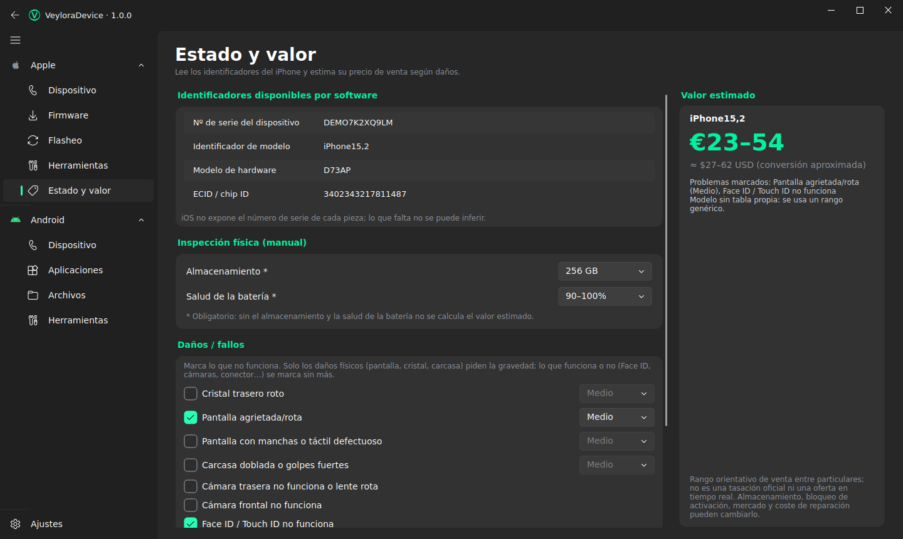
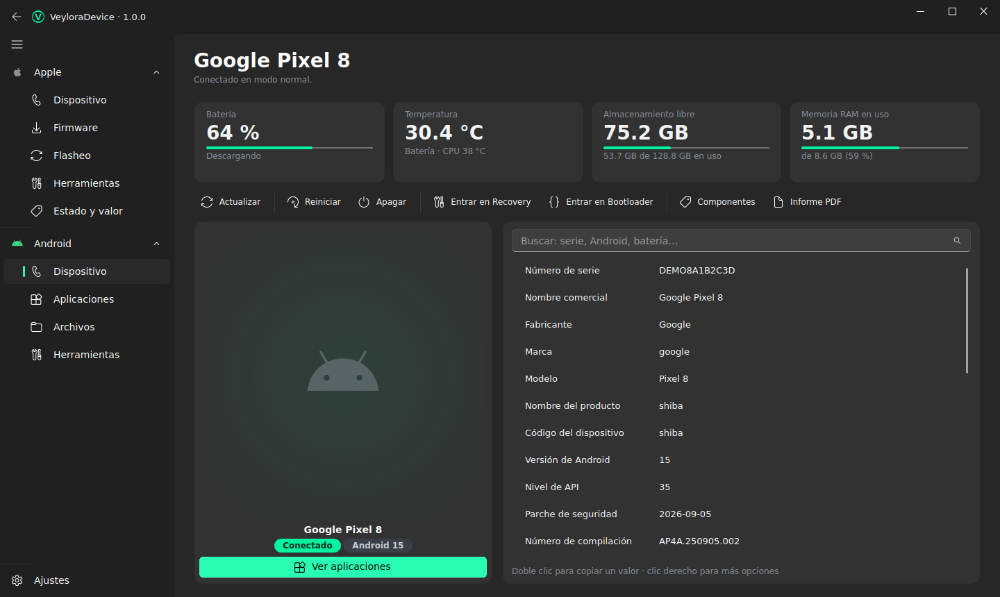
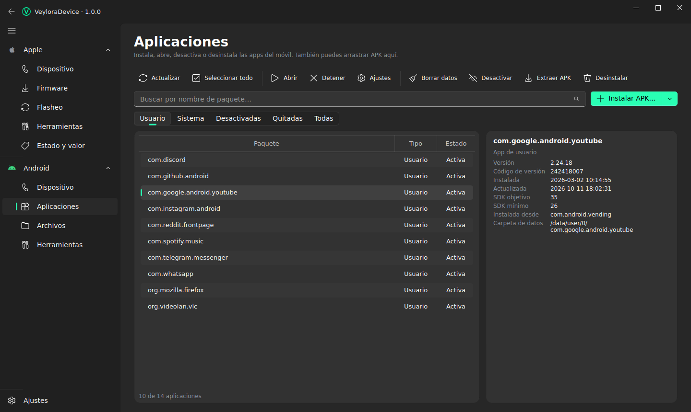
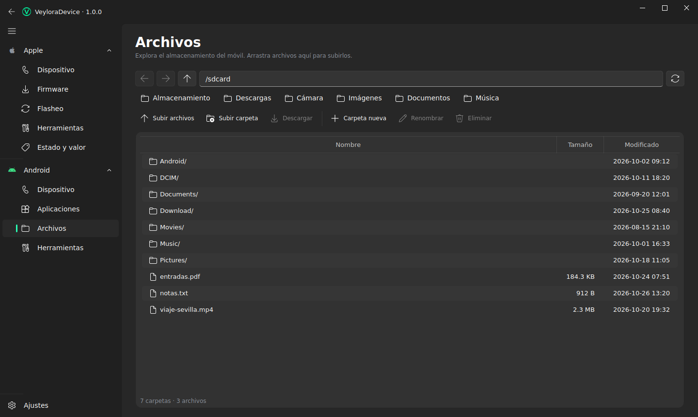
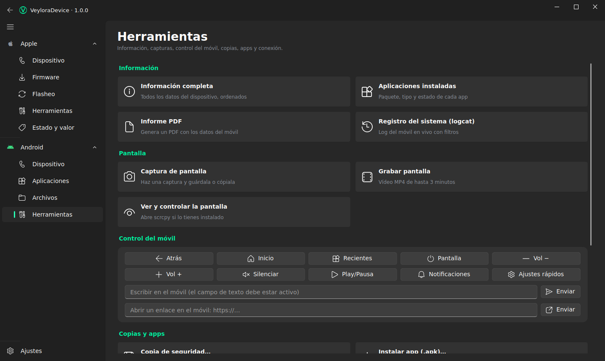
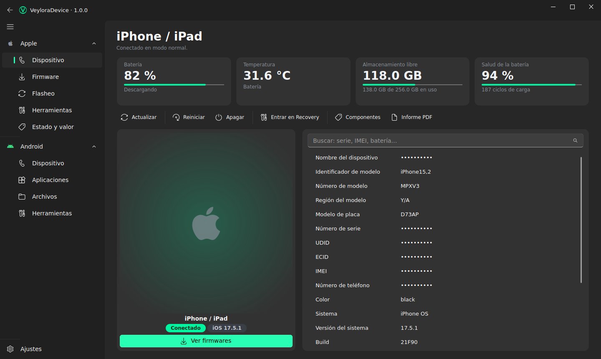
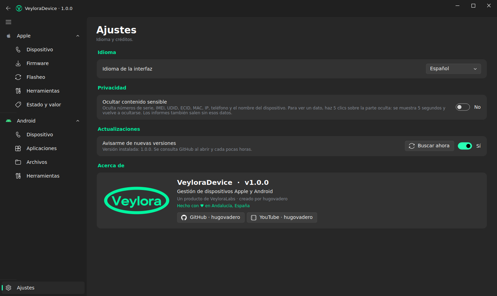
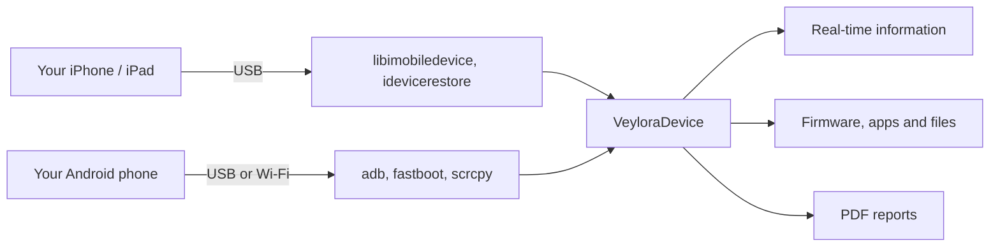

<div align="center">


# VeyloraDevice

**Apple and Android device manager for Linux, all in one window.**

Real-time information, firmware, apps, files, screenshots, and device valuation for your iPhone, iPad, or Android phone.

[](LICENSE)
[](#-download-and-installation)
[](https://github.com/VeyloraLabs/VeyloraDevice/releases/latest)
[](https://www.python.org/)
[](https://doc.qt.io/qtforpython-6/)
[](https://github.com/VeyloraLabs/VeyloraDevice)

[Download](https://github.com/VeyloraLabs/VeyloraDevice/releases/latest) · [Screenshots](#-screenshots) · [Features](#-features) · [Installation](#-download-and-installation) · [Build](#-building-from-source) · [Contributing](#-contributing)

</div>



---

## 📑 Table of Contents

- [Screenshots](#-screenshots)
- [What is it?](#-what-is-it)
- [Features](#-features)
- [Download and installation](#-download-and-installation)
- [Required external tools](#-required-external-tools)
- [Preparing your device](#-preparing-your-device)
- [Usage](#-usage)
- [Privacy](#-privacy)
- [Building from source](#-building-from-source)
- [Project structure](#-project-structure)
- [Troubleshooting](#-troubleshooting)
- [Roadmap](#-roadmap)
- [Contributing](#-contributing)
- [License](#-license)
- [Acknowledgements](#-acknowledgements)

## 📸 Screenshots

> [!NOTE]
> All screenshots use **dummy data** (serial numbers, IMEI, phone numbers, apps, etc.). Without an internet connection, the device image will not load and the Apple or Android logo will be displayed instead.

| Apple · Device | Apple · Status and Value |
|:---:|:---:|
|  |  |
| **Android · Device** | **Android · Apps** |
|  |  |

<details>
<summary><b>View more screenshots</b></summary>

| Android · Files | Android · Tools |
|:---:|:---:|
|  |  |
| **Sensitive content hidden** | **Settings** |
|  |  |

</details>

## 💡 What is it?

VeyloraDevice is a free and open-source alternative to tools such as 3uTools, designed for **Linux**. Connect an iPhone, iPad, or Android phone via USB and manage its information, apps, files, and maintenance tools from a single application, with the same look and controls across both platforms.

It is designed for people who repair, resell, or simply maintain their own devices and do not want to use a separate tool for each platform.



## ✨ Features

### Both platforms

- **Real-time essential information bar**: battery, temperature, available storage, and RAM (Android), or battery health and charge cycles (Apple).
- **Searchable information table**: double-click a value to copy it; right-click for more options.
- **PDF reports** containing device information.
- **Connection assistant**: when something goes wrong, a notification explains the issue and offers a one-click fix.
- **Hide sensitive content**: serial numbers, IMEI, UDID, MAC address, phone number, and device name are hidden; they can be revealed with 5 clicks for 5 seconds.
- **New version notifications** when a new release is available on GitHub.
- **English and Spanish**, switchable instantly.

### Apple (iPhone, iPad, iPod)

| Section | What it does |
|---------|--------------|
| **Device** | Searchable information, restart, shut down, enter and exit Recovery Mode, component details, and reports |
| **Firmware** | Visual IPSW firmware catalogue (ipsw.me) and downloads |
| **Flashing** | Update or restore using `idevicerestore` |
| **Tools** | Installed apps, install `.ipa` files, syslog, backups, and connection repair |
| **Status and Value** | Identifiers and estimated resale value based on device damage |

### Android

| Section | What it does |
|---------|--------------|
| **Device** | Device information, model image, restart, shut down, Recovery, Bootloader, and Fastboot mode (read-only) |
| **Apps** | Search and filter, install APKs (multiple files at once, entire folders, or by dragging and dropping), bulk uninstall, extract APKs, disable apps, and clear app data |
| **Files** | Device file manager: upload, download, rename, create folders, and delete |
| **Tools** | Screenshots and screen recording, remote control, type text and open links, Wi-Fi, ADB terminal, live logcat, and scrcpy |

## 📦 Download and installation

Download the package for your distribution from the [releases page](https://github.com/VeyloraLabs/VeyloraDevice/releases/latest):

| Distribution | Package | Install |
|--------------|---------|---------|
| Debian, Ubuntu, Linux Mint, Pop!_OS | `veyloradevice_X.Y.Z_amd64.deb` | `sudo apt install ./veyloradevice_X.Y.Z_amd64.deb` |
| Fedora, RHEL, Rocky, Alma | `veyloradevice-X.Y.Z-1.x86_64.rpm` | `sudo dnf install ./veyloradevice-X.Y.Z-1.x86_64.rpm` |
| openSUSE | `veyloradevice-X.Y.Z-1.x86_64.rpm` | `sudo zypper install ./veyloradevice-X.Y.Z-1.x86_64.rpm` |
| Any distribution | `VeyloraDevice-X.Y.Z-x86_64.AppImage` | `chmod +x VeyloraDevice-*.AppImage && ./VeyloraDevice-*.AppImage` |
| Any distribution (portable) | `VeyloraDevice-X.Y.Z-linux-x86_64.tar.gz` | `tar xzf VeyloraDevice-*.tar.gz && ./VeyloraDevice-*/VeyloraDevice` |

Verify your download using the `SHA256SUMS` file included in the release:

```bash
sha256sum -c SHA256SUMS --ignore-missing
```

> [!TIP]
> If you install the `.deb` or `.rpm` package, the application will appear in your applications menu as **VeyloraDevice**. You can also launch it using the `veyloradevice` command.

### Run from source

```bash
git clone https://github.com/VeyloraLabs/VeyloraDevice.git
cd VeyloraDevice
./run.sh
```

`run.sh` creates a virtual environment, installs `requirements.txt`, and launches the application. External tools must be installed separately using the commands in [Required external tools](#-required-external-tools).

## 🔧 Required external tools

VeyloraDevice does not bundle these tools; it uses the versions installed on your system. You only need the tools for the platform you intend to use.

<details open>
<summary><b>Fedora</b></summary>

```bash
sudo dnf install -y libimobiledevice libimobiledevice-utils idevicerestore ideviceinstaller usbmuxd libirecovery-utils android-tools
sudo dnf install -y dnf-plugins-core
sudo dnf copr enable -y zeno/scrcpy
sudo dnf install -y scrcpy
sudo systemctl start usbmuxd
```

</details>

<details>
<summary><b>Debian, Ubuntu, and derivatives</b></summary>

```bash
sudo apt install libimobiledevice-utils ideviceinstaller idevicerestore usbmuxd libirecovery-utils adb fastboot scrcpy
```

</details>

<details>
<summary><b>Arch Linux</b></summary>

```bash
sudo pacman -S libimobiledevice usbmuxd ideviceinstaller idevicerestore android-tools scrcpy
```

</details>

| Tool | Purpose | Platform |
|------|---------|----------|
| `libimobiledevice` and `usbmuxd` | Communicate with an iPhone or iPad | Apple |
| `idevicerestore` | Update and restore firmware | Apple |
| `ideviceinstaller` | Install and list apps | Apple |
| `adb` and `fastboot` | Communicate with Android devices | Android |
| `scrcpy` (optional) | View and control the screen | Android |

## 📱 Preparing your device

**iPhone / iPad**: connect it via USB, unlock it, and tap **Trust This Computer**. The application will detect it and launch it automatically if needed.

**Android**:

1. Settings → About phone → tap **Build number** 7 times.
2. Settings → System → Developer options → enable **USB debugging**.
3. Connect the cable and accept the **Allow USB debugging?** prompt.

> [!IMPORTANT]
> **Xiaomi, Redmi, and POCO** devices restrict the computer from pressing Back or Recent Apps, typing, or controlling the screen. You must also enable **USB debugging (Security settings)** in Developer options (this may require your Mi account and a SIM card). Home, volume, media, and notifications work without this setting, and the application will guide you to it if needed.

## 🚀 Usage

1. Open VeyloraDevice and connect your device: the top bar displays its live status.
2. Use the **action bar** on each page (Refresh, Restart, Enter Recovery, etc.).
3. Under **Apps** (Android), select *Install APK* and choose all the files you want, or drag an entire folder into the window. Use *Select all* to uninstall apps in bulk.
4. To share a screenshot or report, enable **Settings → Hide sensitive content**.

### Shortcuts

| Key | Action |
|-----|--------|
| <kbd>F5</kbd> | Refresh |
| <kbd>Ctrl</kbd> + <kbd>F</kbd> | Search (Apps) |
| <kbd>Ctrl</kbd> + <kbd>I</kbd> | Install APK |
| <kbd>Delete</kbd> | Uninstall / delete selection |
| <kbd>Alt</kbd> + <kbd>←</kbd> / <kbd>→</kbd> / <kbd>↑</kbd> | Back, forward, and go up in Files |
| <kbd>F2</kbd> | Rename in Files |

## 🔒 Privacy

- Everything is processed on your computer. VeyloraDevice has no server of its own and does not send your device data anywhere.
- The only outgoing connections are to: `ipsw.me` and Apple's servers (firmware), Google's public device list (Google Play), the Wikipedia API (model name and image, without sending serial numbers), and the GitHub API (to check for new versions).
- When **Hide sensitive content** is enabled, the table, component details, full information view, and PDF reports hide serial numbers, IMEI, UDID, ECID, MAC address, IP address, phone number, and device name.

## 🛠️ Building from source

Everything needed to build the application is in the [`packaging/`](packaging) folder:

```bash
cd packaging
./build.sh
```

The script:

1. Shows the **currently configured version** (`Version to build: 1.0.0`): press <kbd>Enter</kbd> to keep it or edit it to create a new version. The selected version is written to `app/__init__.py`, so the application displays it.
2. Creates its own virtual environment and installs the dependencies.
3. Builds the application with PyInstaller and generates all packages in `packaging/compilation/Linux-<architecture>/`:

```text
packaging/compilation/Linux-x86_64/
├── veyloradevice_X.Y.Z_amd64.deb
├── veyloradevice-X.Y.Z-1.x86_64.rpm
├── VeyloraDevice-X.Y.Z-x86_64.AppImage
├── VeyloraDevice-X.Y.Z-linux-x86_64.tar.gz
└── SHA256SUMS
```

| Option | Effect |
|--------|--------|
| `-v 1.2.0` | Use that version without prompting |
| `-y` | Skip all prompts and keep the current version |
| `-t deb,rpm` | Build only those formats (`tar`, `deb`, `rpm`, `appimage`) |

You need `python3` (with `venv`), `dpkg-deb` for `.deb`, `rpmbuild` for `.rpm`, and `curl` to download `appimagetool`. Missing tools are skipped with a warning.

To publish a release: `./release.sh` (requires the [GitHub CLI](https://cli.github.com) and `gh auth login`).

## 🗂️ Project structure

```text
VeyloraDevice/
├── main.py                 Entry point
├── app/
│   ├── core/               Backend logic (ADB, libimobiledevice, reports…)
│   ├── gui/                Pages and dialogs (PySide6 + Fluent)
│   ├── privacy.py          Hide sensitive content
│   └── update.py           New version notifications
├── assets/                 Logo and icons
├── docs/screenshots/       README screenshots
├── packaging/              Build system (.deb, .rpm, AppImage, .tar.gz)
├── requirements.txt
└── run.sh                  Run from source
```

## 🩺 Troubleshooting

<details>
<summary><b>My Android phone is not detected</b></summary>

Make sure **USB debugging** is enabled and accept the prompt on your phone. If it still does not appear, go to **Tools → Restart ADB server**.

</details>

<details>
<summary><b>It says "Linux cannot access USB"</b></summary>

Disconnect and reconnect the cable. If the issue persists, your user account may not have USB permissions for that device: check your distribution's ADB udev rules.

</details>

<details>
<summary><b>My iPhone will not connect or the "Trust" prompt does not appear</b></summary>

Make sure `usbmuxd` is running (`sudo systemctl start usbmuxd`). The Device tab explains the issue and offers to clear saved pairing records.

</details>

<details>
<summary><b>Control buttons do not work on a Xiaomi or Redmi</b></summary>

Enable **USB debugging (Security settings)** in Developer options. In the meantime, Home, volume, and notifications should still work.

</details>

<details>
<summary><b>I want to clear the cache</b></summary>

Delete the `~/.cache/veylora` folder (model images and catalogues). It will be recreated automatically.

</details>

## 🗺️ Roadmap

- [x] Android Device, Apps, Files, and Tools pages
- [x] Real-time essential information
- [x] Hide sensitive content
- [x] New version notifications
- [x] `.deb`, `.rpm`, AppImage, and `.tar.gz` packages
- [ ] Support for additional architectures (ARM) in releases
- [ ] More languages
- [ ] Flathub package

## 🤝 Contributing

Contributions are welcome.

1. Fork the repository and create a branch: `git checkout -b my-improvement`
2. Follow the existing code style (no comments, clear names).
3. Test your changes with a real device if possible.
4. Open a *pull request* explaining what changed and why.

To report a bug, open an *issue* with your distribution, device model, and steps to reproduce it. **Do not post serial numbers or IMEI numbers**: enable *Hide sensitive content* before taking screenshots or generating a report.

## 📄 License

Distributed under the **GNU GPL v3** license. See [LICENSE](LICENSE).

VeyloraDevice uses [PySide6-Fluent-Widgets](https://github.com/zhiyiYo/PyQt-Fluent-Widgets), which is dual-licensed: GPLv3 for non-commercial use and a paid commercial license for commercial use. This is why the project is licensed under GPLv3. If you want to use it commercially, you must also comply with that license. Full details are available in [THIRD_PARTY_NOTICES.md](THIRD_PARTY_NOTICES.md).

Apple, iPhone, iPad, and iOS are trademarks of Apple Inc. Android is a trademark of Google LLC. VeyloraDevice is an independent project and is not affiliated with these companies.

## 🙏 Acknowledgements

- [libimobiledevice](https://libimobiledevice.org/) and [idevicerestore](https://github.com/libimobiledevice/idevicerestore)
- [ipsw.me](https://ipsw.me/) for its public firmware API
- [PyQt-Fluent-Widgets](https://github.com/zhiyiYo/PyQt-Fluent-Widgets) for the interface
- [scrcpy](https://github.com/Genymobile/scrcpy) and the Android platform tools

---

<div align="center">

Made with ❤️ by **[VeyloraLabs](https://github.com/VeyloraLabs)** · created by [hugovadero](https://github.com/hugovadero)

</div>
